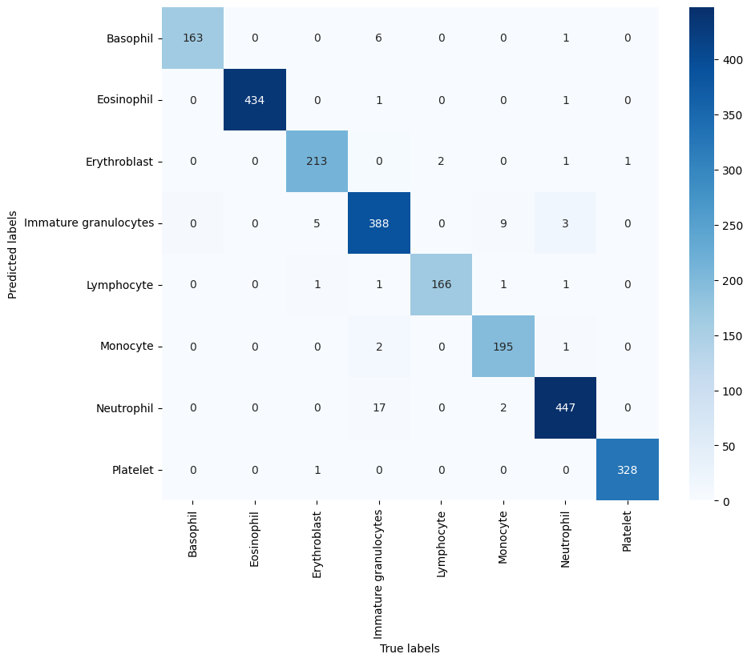

# Blood cell image classification

Academic team project comparing convolutional networks for classifying blood cell images into eight classes, with an emphasis on data cleaning, augmentation and model error analysis.

## Start here

Read the [project report](Report.pdf), then inspect the [baseline notebook](Notebooks/FORmidable_basic_model.ipynb) and the [custom MobileNetV3 experiment](Notebooks/FORmidable_MNV3_heavy_custom.ipynb). These files document team experiments; individual component ownership is not specified here.

## Experimental workflow

```text
Images → cleaning and deduplication → stratified splits → augmentation
       → model training → held-out evaluation and confusion matrices
```

The notebooks explore a basic CNN, pretrained MobileNetV2, custom MobileNetV3 variants and a weighted-loss variant. The augmentation code includes RandAugment, GridMask and Gaussian noise. PCA-based feature visualisation helps inspect class separability.



Historical confusion matrix from the custom heavy MobileNetV3 notebook. Saved notebook output, extracted without rerunning the experiment.

## Recorded results

The following values come directly from saved notebook test-set outputs. They have not been rerun for this documentation update and are not official competition leaderboard scores.

| Notebook | Recorded local test accuracy |
| --- | ---: |
| [Basic CNN](Notebooks/FORmidable_basic_model.ipynb) | 89.00% |
| [Custom MobileNetV3, heavy](Notebooks/FORmidable_MNV3_heavy_custom.ipynb) | 97.62% |
| [Custom MobileNetV3, weighted loss](Notebooks/FORmidable_MNV3_heavy_custom_weighted_loss.ipynb) | 97.62% |

The heavy custom model's saved test output contains 2,391 images. Its 98.75% best validation accuracy is a different metric from the 97.62% test accuracy. Treat these as historical per-notebook observations: identical splits across separate runs and fresh reproducibility have not been verified.

## Repository guide

| File | Purpose |
| --- | --- |
| [Basic model](Notebooks/FORmidable_basic_model.ipynb) | Commented preprocessing, baseline training and evaluation |
| [Pretrained MobileNetV2](Notebooks/FORmidable_MNV2_pretrained.ipynb) | Transfer-learning experiment |
| [Light MobileNetV3](Notebooks/FORmidable_MNV3_light_custom.ipynb) | Custom architecture experiment |
| [Heavy MobileNetV3](Notebooks/FORmidable_MNV3_heavy_custom.ipynb) | Larger custom architecture |
| [Weighted loss](Notebooks/FORmidable_MNV3_heavy_custom_weighted_loss.ipynb) | Class-weighted categorical cross-entropy experiment |
| [PCA](Notebooks/FORmidable_PCA.ipynb) | Feature-space exploration |
| [Preprocessing](Notebooks/preprocessing.py) | Augmentation and dataset helpers |
| [Model wrapper](Notebooks/model.py) | Competition inference wrapper |

## Data and execution

The original `training_set.npz` and trained model files are not included. Obtain the competition dataset through its authorised distribution channel and follow its usage terms.

1. Open a notebook with `Notebooks/` as the working directory so that imports of `preprocessing.py` resolve.
2. Set the `np.load(...)` dataset path; some notebooks use a Kaggle-specific path.
3. Use an environment with TensorFlow, Keras, KerasCV, NumPy, pandas, scikit-learn, matplotlib, seaborn and OpenCV. The PCA notebook uses additional packages, including PyTorch, torchvision, Plotly, Pillow and Albumentations.
4. Check model-save directories and GPU/mixed-precision settings before training.
5. Run the baseline first, then follow the architecture-specific notebooks.

No tested dependency lockfile is supplied. TensorFlow/Keras/KerasCV API compatibility needs checking when recreating the environment. Training can be computationally expensive; saved outputs and the report can be reviewed without training.

## Evaluation limits

These experiments use local image-level splits and do not establish patient-level generalisation or clinical validity. Seeds appear in the notebooks, but split calls do not consistently specify `random_state`. Model selection, class imbalance and the relationship between the competition data and unseen clinical data should be considered before interpreting the results.
